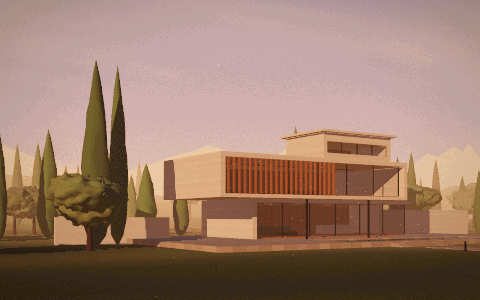
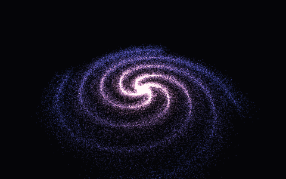
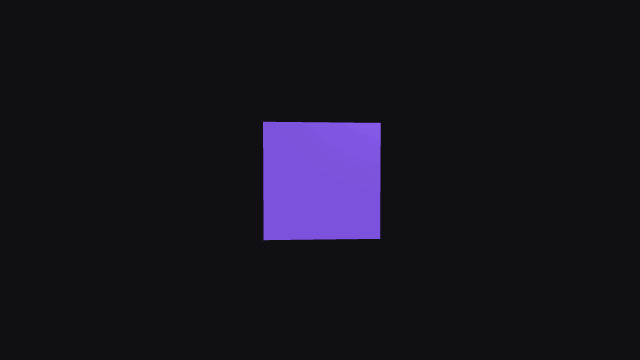

# Three.js Projects

A library of small 3D projects built with [Three.js](https://threejs.org/) and [Vite](https://vite.dev/).

## Projects

| Demo | Project | Description |
| --- | --- | --- |
|  | [Architectural Hero](projects/architectural-hero/) | A cinematic hero section filming a house as the sun goes down |
|  | [Particle Galaxy](projects/particle-galaxy/) | A spiral galaxy made of 60,000 particles |
|  | [Rotating Cube](projects/rotating-cube/) | A rotating purple cube you can view from any angle |

## Getting started

This project uses [pnpm](https://pnpm.io/). Install the dependencies, then start the development server:

```bash
pnpm install
pnpm dev
```

Then open the address shown in your terminal: the home page lists every project.

## Commands

```bash
pnpm dev      # Start the development server
pnpm build    # Build the home page and every project into dist/
pnpm preview  # Serve the production build locally
```

## Project structure

```text
├── index.html           # Home page listing the projects
├── vite.config.js       # Finds the projects and fills in the home page
├── public/              # Static files served from the root (favicon)
└── projects/
    └── rotating-cube/
        ├── index.html   # Project entry point
        ├── README.md    # Project description and controls
        ├── demo.gif     # Optional animation shown on the home page and in the READMEs
        └── src/         # Project code and styles
```

Any folder in `projects/` with an `index.html` is detected automatically by `vite.config.js`.

## License

This project is licensed under the [ISC License](LICENSE).
