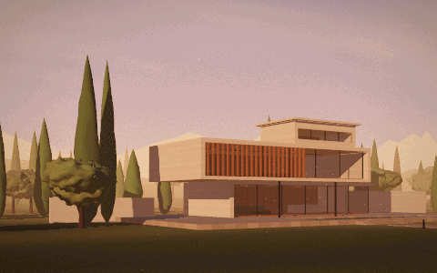

# Architectural Hero

A cinematic, fullscreen 3D hero section showing Solstice House, a fictional residence. The camera moves through four shots as the sun goes down, the rooms light up one after another and the pool mirrors the building. Everything is generated in code, with no external models or textures.

	

## Controls

The film plays by itself. Use **Pause** to stop it, or a chapter in the bottom bar to jump to a shot. **Explore the house** hands the camera over to you:

| Action | Mouse | Touch | Keyboard |
| --- | --- | --- | --- |
| Orbit around the house | Left-click + drag | Drag with one finger | Arrow keys |
| Zoom in or out | Scroll wheel | Pinch with two fingers | – |
| Pan the view | Right-click + drag | Drag with two fingers | – |

If your system asks for reduced motion, the film starts paused on its last shot.
