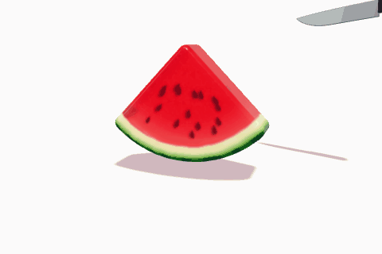

# Jelly Watermelon

A wobbly slice of watermelon made of translucent jelly, on a white background. Cut it with a knife as many times as you like: every piece keeps wobbling, falls, and bounces off the others.

	

## Controls

| Action | Mouse | Touch | Keyboard |
| --- | --- | --- | --- |
| Cut with the knife | Left-click + drag across the slice | Drag with one finger | – |
| Poke the jelly | Left-click | Tap | – |
| Orbit around the slice | Right-click + drag | Drag with two fingers | Arrow keys |
| Zoom in or out | Scroll wheel | Pinch with two fingers | – |
| Pan the view | Middle-click + drag | – | – |
| Get a new slice | "New slice" button | "New slice" button | `R` |

## How it works

- **Jelly physics:** the slice is filled with tetrahedra simulated as a stable neo-Hookean material with XPBD. Jelly resists shear softly, barely changes volume, and its viscosity damps the wobble but not the movement of the whole piece.
- **Cutting:** the line you draw defines a plane going through the camera. The tetrahedra are separated along it, and the rendered surface is clipped and capped with a new cut face.
- **Colors:** each pixel gets its color from its position in the original slice, so a cut always reveals the right mix of flesh, rind and skin. Seeds are real objects inside the jelly, visible through it.
- **Collisions:** two pieces of a convex slice can always be separated by a plane, so each pair of pieces keeps track of one. They flatten against it like soft bodies.

## Tweaking the jelly

The constants at the top of `src/main.js` control the slice: softness (`SHEAR_MODULUS`), how long it wobbles (`VISCOSITY`), gravity, friction, shape, and physical resolution (`LATTICE_CELL`).
