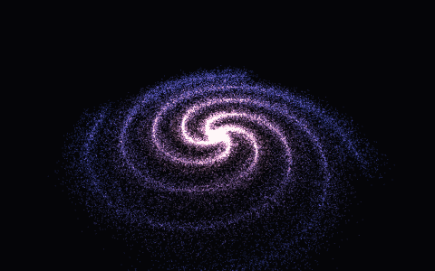

# Particle Galaxy

A slowly rotating spiral galaxy made of 60,000 particles, glowing from a warm core to blue outer arms.

	

## Controls

| Action | Mouse | Touch | Keyboard |
| --- | --- | --- | --- |
| Orbit around the galaxy | Left-click + drag | Drag with one finger | Arrow keys |
| Zoom in or out | Scroll wheel | Pinch with two fingers | – |
| Pan the view | Right-click + drag | Drag with two fingers | – |

## Tweaking the galaxy

The constants at the top of `src/main.js` control its shape: number of stars, radius, number of arms, twist, and colors.
